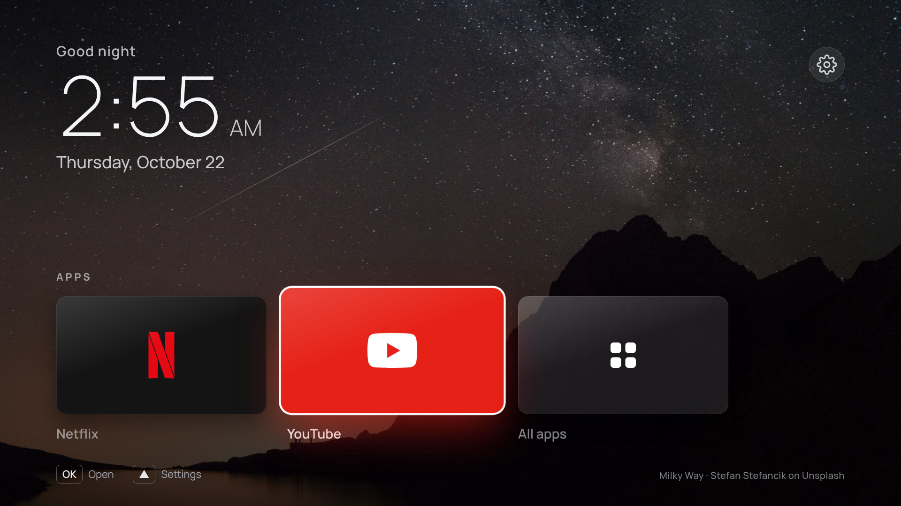

# TV Launcher

A quiet home screen for the living-room **Samsung The Frame QN65LS03B** (2022, Tizen 6.5): a
clock over a rotating photo, Netflix, YouTube, and nothing else.



Based on [NelsonEU/arn0-tv](https://github.com/NelsonEU/arn0-tv) (MIT, see [LICENSE](LICENSE)),
which was built and tested on a 2022 Samsung Q70B, the same Tizen 6.5 generation as this Frame.
The full upstream reference (remote shortcuts, settings, wallpapers, HDMI, performance notes) is in
[docs/UPSTREAM-README.md](docs/UPSTREAM-README.md).

## What changed from upstream

| | |
| --- | --- |
| Apps row | Netflix and YouTube, matched by any of Samsung's known app ids or the exact store name |
| Consoles row | Empty, so it is hidden. Add consoles later in Settings → Consoles |
| Locale / clock | `en-US`, 12-hour clock by default |
| Look | Photo wallpapers on by default (rotating hourly, crossfading), a greeting above a larger clock, big 16:9 tiles that lift and glow in the brand's colour when focused, the photo's credit bottom-right. With consoles added, Home switches back to the compact two-row layout |
| Settings | Rows tightened so the last one no longer sits under the remote hints (also happens upstream) |
| Tizen app id | `KchTvLnchr.Launcher` (package `KchTvLnchr`), shown as "TV Launcher" |
| Build output | `dist/tv-launcher.wgt` |
| Not copied | `native/` and the Home-button / power-on guide. Upstream only tested that on one Q70B and calls The Frame untested; it rewrites undocumented TV preferences. The launcher works fine opened from the app list |

Everything you'd normally tweak is in [`src/js/config.js`](src/js/config.js). Settings changed on
the TV itself are saved there and override `config.js`.

## Try it in a browser

Needs Node 20+. No TV involved; Tizen APIs are faked by `src/js/tizen-mock.js`.

```sh
pnpm --filter @kch/tv-launcher preview      # http://localhost:8080
```

Arrow keys + Enter navigate, Esc/Backspace is Back, `R` `G` `Y` `B` are the remote's colour keys.

## Put it on the Frame

You need a computer on the same Wi-Fi/LAN as the TV.

1. **Build the package.**

   ```sh
   pnpm --filter @kch/tv-launcher build      # -> apps/tv-launcher/dist/tv-launcher.wgt
   ```

2. **Turn on Developer Mode on the TV.** Open **Apps**, then enter `1 2 3 4 5` (on the Solar
   remote, press the `123` button to bring up the on-screen number pad). Switch **Developer mode**
   on, type your computer's local IP address, confirm, then restart the TV (hold the power button
   until the Samsung logo appears).

3. **Sign and install.** 2022 Samsung TVs only accept packages signed with a Samsung certificate
   that includes the TV's DUID. Either:
   - **Apps2Samsung** (Windows): choose **Custom WGT File** and pick `tv-launcher.wgt`; it signs
     and installs in one step.
   - **Tizen Studio CLI**: install Tizen Studio with the *Samsung Certificate Extension* and
     *TV Extensions*, then:

     ```sh
     sdb connect <TV_IP>
     # Certificate Manager → new Samsung certificate profile (it reads the DUID from the TV)
     tizen package -t wgt -s <profile> -- apps/tv-launcher/dist/tv-launcher.wgt
     tizen install -n tv-launcher.wgt -- apps/tv-launcher/dist
     ```

   Keep using the same certificate profile for updates; a different one forces an uninstall,
   which wipes the launcher's saved settings.

4. **Open it** from the TV's Apps list ("TV Launcher"). Check: Netflix and YouTube open, Up
   reaches Settings, and a setting survives a restart.

If a tile is missing, press **Red** (All apps), focus the app and read its id at the bottom-left,
then pin it in `config.js` as `{ id: '<that id>', label: 'Netflix' }` and rebuild.

### Frame notes

- Art Mode is untouched; the launcher is an ordinary app and only runs while it is open.
- The Home button still opens Samsung's Smart Hub. The launcher's **Settings → Samsung Home** entry
  jumps there too, which is where TV settings live.
- The built-in screen saver (moving photos, clock that shifts corners) only runs on the launcher's
  Home screen. Since the panel is an Art Mode TV, Settings → Screen saver is the place to turn it
  off if you'd rather rely on Art Mode.
